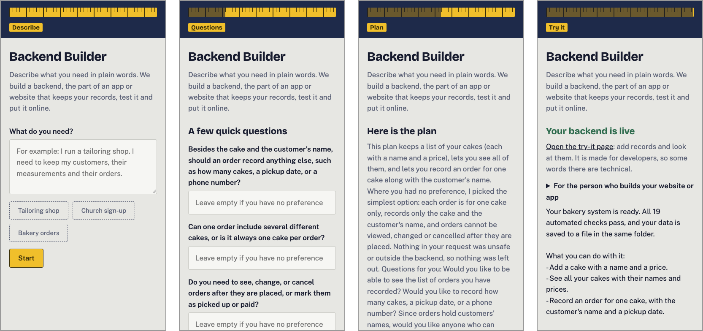
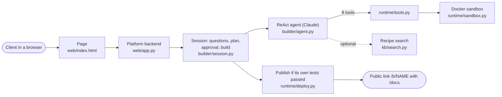

# Prosit 2: A Platform That Lets Non-Developers Build Backend APIs

ICS554 Natural Language Processing, Ashesi University. NLP Group 1: Michael Boadi, Joseph Etse, Alice Kara-Acquah, Bernard Marfo, Eric Sunu.

**Live platform:** https://34-78-38-126.sslip.io (each build spends real Claude credit, about $0.20)

A non-developer describes a backend in plain words, for example "I run a car dealership and need to track my cars, sales and profit". A coding agent asks up to 3 questions and shows a plan for them to approve. It then writes a FastAPI backend with a SQLite database and tests it in a locked Docker sandbox. Finally, it publishes the backend at a public link with a `/docs` page listing its endpoints. The client can send a message during the build, and the agent takes it in.



## Results at a glance

All numbers come from saved files in [`eval/results/`](eval/results/README.md). An audit matched 105 of 105 numbers written in the report to those files ([`AUDIT.md`](eval/results/AUDIT.md)).

| What we measured | Result |
|---|---|
| Hidden tests passed on our 15-request benchmark (192 tests the agent never sees) | Agent **96.0%**; one Claude call with no tools 84.0% |
| Data still there after a restart | Agent kept it in 30 of 30 checkable builds; one call lost it on 13 of 15 tasks |
| Asking up to 3 questions first | 96.0% against 90.1% without questions |
| One agent against a Planner, Builder and Tester split | 96.0% at $1.91 against 87.0% at $4.06 for all 15 tasks |
| Recipe search (RAG): right recipe in the top 3 | Dense (MiniLM) 95%, hybrid 87%, BM25 74%, random 17% |
| Safety | Docker blocked 15 of 16 harmful-code attacks; hidden instructions obeyed in 0 of 9 builds |
| Live build on the public link | Live in 53 s; a message sent mid-build was obeyed in 8 of 8 builds |
| Usability (one non-developer, alone) | Live backend in about 10 minutes; SUS score 82.5 (68 is average) |

The full write-up is [`docs/section-b.md`](docs/section-b.md), which is Section B of the report.

`main` holds only what the live platform, the command line and the marker run (decision 0063). The experiment scripts and switches behind the numbers above are unchanged at the tag [`report-experiments`](https://github.com/ASU-MICS-2028/nlp-group-1-prosit-2/tree/report-experiments).

## How it works



| Folder | What is in it | Owner |
|---|---|---|
| [`builder/`](builder/) | The agent (questions, plan, ReAct build loop), the session states, the Claude calls, the command line | Alice (W1) |
| [`runtime/`](runtime/) | The 8 tools, the Docker sandbox, publishing | Bernard (W2), Joseph (W4) |
| [`web/`](web/) | The page the client uses (`index.html`) and the platform server (`app.py`) | Michael (W3, page), Joseph (W4, server) |
| [`benchmark/`](benchmark/README.md) | 15 plain-language requests, each with hidden tests and a correct reference backend | Joseph (W4) |
| [`eval/`](eval/) | The marker (`harness.py`, `bench.py`), the usability kit, the number audit, and every saved result | Joseph (W4), Eric (W5) |
| [`kb/`](kb/) | 18 recipes and the search that retrieves them (RAG) | Joseph (W4) |
| [`docs/`](docs/README.md) | The plan, 63 numbered decision records, and Section B | Everyone |
| [`learnings/`](learnings/README.md) | Each workstream's experiment log in plain words, with the options that lost | Each owner |
| [`knowledge/`](knowledge/README.md) | The assignment, course, team, setup and lecture summaries | Everyone |

## Running it yourself

You need Python with [uv](https://docs.astral.sh/uv/), Docker running, and an Anthropic API key. Full setup: [`knowledge/environment.md`](knowledge/environment.md).

```
uv sync                                  # install dependencies
cp .env.example .env                     # then add your API key (never commit .env)

# the platform on a laptop: open http://localhost:8080 (building works; publishing needs the server)
uv run --env-file .env --with anthropic python -m uvicorn web.app:app --port 8080

# or build one benchmark task from the command line (about $0.10)
uv run --env-file .env --with anthropic python -m builder build church_signup --run try1

# check the marker is fair: every correct reference backend gets full marks (free, about 15 s)
uv run python -m eval.harness all --references
```

The public server is set up with [`web/setup_server.sh`](web/setup_server.sh).

## How we worked

- **Every choice was tested against its alternatives.** Each comparison is logged in [`learnings/`](learnings/README.md), with the numbers and the options that lost. Each decision has a record in [`docs/decisions/`](docs/decisions/README.md).
- **Every result is saved** in [`eval/results/`](eval/results/README.md) (decision 0051). If it is not there, it is not in the report.
- **One owner per workstream:** W1 Alice (agent), W2 Bernard (tools and sandbox), W3 Michael (page design), W4 Joseph (benchmark, recipe search, live platform), W5 Eric (integration and report). Merges go through pull requests.
- **This repo is public.** It holds no API keys or personal details, and raw transcripts are never committed: only summaries go in [`knowledge/lectures/`](knowledge/lectures/README.md).
- Coding assistants working here: see [`AGENTS.md`](AGENTS.md).
