# Plan

**We work as a relay: one person at a time.** Each person does their whole part, tries every alternative (rule 2), and writes it all down in their learnings file (rule 1). Then the next person takes over, building on what was handed to them. Nobody works on a part before the part it needs is finished, so every blocker in this plan is real: *this must be done before that can be done*. There is no fixed deadline. Doing each part fully and learning from it comes first.

**A handoff** is the last task of every stage: the owner's learnings file is complete, including "How the next person uses this". The next stage starts with the new owner reading it and running what was handed over. If something is unclear or doesn't run, it goes back to the previous owner before anything else happens.

**How to use this file.** Edit only the stage tables: set `Status` to `doing` when you start a task, `done` when its "Done when" is true. Then run `python3 scripts/update_status.py`. It redraws the board, the flow diagram, "By person", "Who waits on whom" and the README's Status section. Commit everything together. A GitHub check fails if any of it is stale.

`Priority` says what matters most inside a stage: finish every `Must`, then `Should`, then `Could`.

## Board: stage by person

<!-- BOARD:START -->
| Who | Stage 0 Set up (everyone) | Stage 1 Bernard — tools and sandbox | Stage 2 Joseph — benchmark, harness, knowledge base | Stage 3 Alice — agent core | Stage 4 Michael — UI and usability | Stage 5 Joseph — full evaluation | Stage 6 Eric — integration and writing | Stage 7 Everyone — review, viva, submit |
|---|---|---|---|---|---|---|---|---|
| Alice (W1) | — | — | — | ⏳ S3.1 Read Bernard's and Joseph's learnings, run their parts ⏳ S3.2 Single agent from the command line ⏳ S3.3 Run record and trace ⏳ S3.4 Test-and-repair loop ⏳ S3.5 Spec-first plan and approval ⏳ S3.6 Planner / Builder / Tester split ⏳ S3.7 Retrieval in the agent ⏳ S3.8 Clarifying questions ⏳ S3.9 Claude vs local Qwen ⏳ S3.10 "Change it" edit loop ⏳ S3.11 Handoff: Alice's learnings | — | — | — | — |
| Bernard (W2) | — | 🔵 S1.1 The agent's tools ⏳ S1.2 Sandbox ⏳ S1.3 Safety tests ⏳ S1.4 MCP server ⏳ S1.5 Handoff: Bernard's learnings | — | — | — | — | — | — |
| Michael (W3) | — | — | — | — | ⏳ S4.1 Read Alice's learnings, run a build ⏳ S4.2 UI on a recorded session ⏳ S4.3 UI on the live agent ⏳ S4.4 UI alternatives compared ⏳ S4.5 Usability test ⏳ S4.6 Handoff: Michael's learnings | — | — | — |
| Joseph (W4) | 🟡 S0.2 LLM setup (Joseph holds the key) | — | ⏳ S2.1 Read Bernard's learnings, run his tools ⏳ S2.2 15 benchmark tasks ⏳ S2.3 Eval harness ⏳ S2.4 Recipe knowledge base and search ⏳ S2.5 Handoff: Joseph's learnings, part 1 | — | — | ⏳ S5.1 Read Alice's and Michael's learnings ⏳ S5.2 Full system on all 15 tasks ⏳ S5.3 Ablations ⏳ S5.4 Model comparison ⏳ S5.5 Results tables and charts ⏳ S5.6 Handoff: Joseph's learnings, part 2 | — | — |
| Eric (W5) | ✅ S0.1 Set up the repo ✅ S0.3 Assign owners 🟡 S0.4 Ask the instructor: dates, "Section C" | — | — | — | — | — | ⏳ S6.1 Read every learnings file, run everything ⏳ S6.2 Fix what doesn't fit together ⏳ S6.3 Section B draft ⏳ S6.4 Slides and recorded demo ⏳ S6.5 Handoff: Eric's learnings | — |
| Everyone | 🔵 S0.6 Docker on every laptop | — | — | — | — | — | — | ⏳ S7.1 Review Section B for your part 🔵 S7.2 Section A (individual, any time) ⏳ S7.3 Viva walkthrough ⏳ S7.4 Rehearse and submit |

✅ done · 🟡 in progress · 🔵 ready to start · ⏳ waiting on another task
<!-- BOARD:END -->

## Flow: what blocks what

Arrows point from a task to the tasks that need it.

```mermaid
flowchart LR
  subgraph Stage0["Stage 0: Set up (everyone)"]
    S0_1["S0.1 Set up the repo<br/>W5 · Must"]:::done
    S0_2["S0.2 LLM setup (Joseph holds the key)<br/>W4 · Must"]:::doing
    S0_3["S0.3 Assign owners<br/>W5 · Must"]:::done
    S0_4["S0.4 Ask the instructor: dates, 'Section C'<br/>W5 · Should"]:::doing
    S0_6["S0.6 Docker on every laptop<br/>All · Should"]:::ready
  end
  subgraph Stage1["Stage 1: Bernard — tools and sandbox"]
    S1_1["S1.1 The agent's tools<br/>W2 · Must"]:::ready
    S1_2["S1.2 Sandbox<br/>W2 · Must"]:::waiting
    S1_3["S1.3 Safety tests<br/>W2 · Should"]:::waiting
    S1_4["S1.4 MCP server<br/>W2 · Could"]:::waiting
    S1_5["S1.5 Handoff: Bernard's learnings<br/>W2 · Must"]:::waiting
  end
  subgraph Stage2["Stage 2: Joseph — benchmark, harness, knowledge base"]
    S2_1["S2.1 Read Bernard's learnings, run his tools<br/>W4 · Must"]:::waiting
    S2_2["S2.2 15 benchmark tasks<br/>W4 · Must"]:::waiting
    S2_3["S2.3 Eval harness<br/>W4 · Must"]:::waiting
    S2_4["S2.4 Recipe knowledge base and search<br/>W4 · Should"]:::waiting
    S2_5["S2.5 Handoff: Joseph's learnings, part 1<br/>W4 · Must"]:::waiting
  end
  subgraph Stage3["Stage 3: Alice — agent core"]
    S3_1["S3.1 Read Bernard's and Joseph's learnings, run their parts<br/>W1 · Must"]:::waiting
    S3_2["S3.2 Single agent from the command line<br/>W1 · Must"]:::waiting
    S3_3["S3.3 Run record and trace<br/>W1 · Must"]:::waiting
    S3_4["S3.4 Test-and-repair loop<br/>W1 · Must"]:::waiting
    S3_5["S3.5 Spec-first plan and approval<br/>W1 · Must"]:::waiting
    S3_6["S3.6 Planner / Builder / Tester split<br/>W1 · Should"]:::waiting
    S3_7["S3.7 Retrieval in the agent<br/>W1 · Should"]:::waiting
    S3_8["S3.8 Clarifying questions<br/>W1 · Should"]:::waiting
    S3_9["S3.9 Claude vs local Qwen<br/>W1 · Should"]:::waiting
    S3_10["S3.10 'Change it' edit loop<br/>W1 · Could"]:::waiting
    S3_11["S3.11 Handoff: Alice's learnings<br/>W1 · Must"]:::waiting
  end
  subgraph Stage4["Stage 4: Michael — UI and usability"]
    S4_1["S4.1 Read Alice's learnings, run a build<br/>W3 · Must"]:::waiting
    S4_2["S4.2 UI on a recorded session<br/>W3 · Must"]:::waiting
    S4_3["S4.3 UI on the live agent<br/>W3 · Must"]:::waiting
    S4_4["S4.4 UI alternatives compared<br/>W3 · Should"]:::waiting
    S4_5["S4.5 Usability test<br/>W3 · Should"]:::waiting
    S4_6["S4.6 Handoff: Michael's learnings<br/>W3 · Must"]:::waiting
  end
  subgraph Stage5["Stage 5: Joseph — full evaluation"]
    S5_1["S5.1 Read Alice's and Michael's learnings<br/>W4 · Must"]:::waiting
    S5_2["S5.2 Full system on all 15 tasks<br/>W4 · Must"]:::waiting
    S5_3["S5.3 Ablations<br/>W4 · Must"]:::waiting
    S5_4["S5.4 Model comparison<br/>W4 · Should"]:::waiting
    S5_5["S5.5 Results tables and charts<br/>W4 · Must"]:::waiting
    S5_6["S5.6 Handoff: Joseph's learnings, part 2<br/>W4 · Must"]:::waiting
  end
  subgraph Stage6["Stage 6: Eric — integration and writing"]
    S6_1["S6.1 Read every learnings file, run everything<br/>W5 · Must"]:::waiting
    S6_2["S6.2 Fix what doesn't fit together<br/>W5 · Must"]:::waiting
    S6_3["S6.3 Section B draft<br/>W5 · Must"]:::waiting
    S6_4["S6.4 Slides and recorded demo<br/>W5 · Must"]:::waiting
    S6_5["S6.5 Handoff: Eric's learnings<br/>W5 · Must"]:::waiting
  end
  subgraph Stage7["Stage 7: Everyone — review, viva, submit"]
    S7_1["S7.1 Review Section B for your part<br/>All · Must"]:::waiting
    S7_2["S7.2 Section A (individual, any time)<br/>All · Must"]:::ready
    S7_3["S7.3 Viva walkthrough<br/>All · Must"]:::waiting
    S7_4["S7.4 Rehearse and submit<br/>All · Must"]:::waiting
  end
  S1_1 --> S1_2
  S1_2 --> S1_3
  S1_1 --> S1_4
  S1_3 --> S1_5
  S1_5 --> S2_1
  S2_1 --> S2_2
  S2_2 --> S2_3
  S2_1 --> S2_4
  S2_3 --> S2_5
  S2_4 --> S2_5
  S2_5 --> S3_1
  S0_2 --> S3_1
  S3_1 --> S3_2
  S3_2 --> S3_3
  S3_2 --> S3_4
  S3_2 --> S3_5
  S3_4 --> S3_6
  S3_2 --> S3_7
  S3_5 --> S3_8
  S3_4 --> S3_9
  S3_5 --> S3_10
  S3_3 --> S3_11
  S3_6 --> S3_11
  S3_7 --> S3_11
  S3_8 --> S3_11
  S3_11 --> S4_1
  S4_1 --> S4_2
  S4_2 --> S4_3
  S4_3 --> S4_4
  S4_4 --> S4_5
  S4_5 --> S4_6
  S4_6 --> S5_1
  S5_1 --> S5_2
  S5_2 --> S5_3
  S5_2 --> S5_4
  S5_3 --> S5_5
  S5_4 --> S5_5
  S5_5 --> S5_6
  S5_6 --> S6_1
  S6_1 --> S6_2
  S6_1 --> S6_3
  S6_2 --> S6_4
  S6_3 --> S6_4
  S6_4 --> S6_5
  S6_3 --> S7_1
  S6_5 --> S7_3
  S7_1 --> S7_4
  S7_2 --> S7_4
  S7_3 --> S7_4
  classDef done fill:#d3f9d8,stroke:#2b8a3e
  classDef doing fill:#fff3bf,stroke:#e67700
  classDef ready fill:#d0ebff,stroke:#1971c2
  classDef waiting fill:#f1f3f5,stroke:#868e96
```

<!-- FLOW:START -->

Green: done · yellow: in progress · blue: ready to start · grey: waiting on the tasks with arrows into it.
<!-- FLOW:END -->

## Stage 0: Set up (everyone)

| ID | Task | Who | Needs | Priority | Status | Done when |
|---|---|---|---|---|---|---|
| S0.1 | Set up the repo | W5 | — | Must | done | Rules, docs, learnings, knowledge and the worked benchmark example are on GitHub |
| S0.2 | LLM setup (Joseph holds the key) | W4 | — | Must | doing | Claude key and local Qwen both tested (Oct 20). Remaining: the check in `knowledge/environment.md` passes on Alice's laptop and the demo machine |
| S0.3 | Assign owners | W5 | — | Must | done | Owner column in "By person" filled in (Oct 20) |
| S0.4 | Ask the instructor: dates, "Section C" | W5 | — | Should | doing | Asked Oct 21. Until a reply comes: no Section C. Answers go in `docs/DECISIONS.md` |
| S0.6 | Docker on every laptop | All | — | Should | todo | `docker run --rm hello-world` works for all 5 |

## Stage 1: Bernard — tools and sandbox

| ID | Task | Who | Needs | Priority | Status | Done when |
|---|---|---|---|---|---|---|
| S1.1 | The agent's tools | W2 | — | Must | todo | Write, read and list files; run tests; start a server; send an HTTP request. Each works on `benchmark/church_signup/reference`. Tool output size and error formats compared |
| S1.2 | Sandbox | W2 | S1.1 | Must | todo | Generated code runs isolated (no network, CPU/memory caps, timeout). Docker vs subprocess compared on speed and isolation |
| S1.3 | Safety tests | W2 | S1.2 | Should | todo | Every attack in the safety list tried (deleting files, reading secrets, network calls, prompt injection in a field description); the result of each recorded |
| S1.4 | MCP server | W2 | S1.1 | Could | todo | An MCP client (e.g. Claude Desktop) can call the tools |
| S1.5 | Handoff: Bernard's learnings | W2 | S1.2, S1.3 | Must | todo | `learnings/W2-*.md` complete, including how the next person uses the tools and the sandbox |

## Stage 2: Joseph — benchmark, harness, knowledge base

| ID | Task | Who | Needs | Priority | Status | Done when |
|---|---|---|---|---|---|---|
| S2.1 | Read Bernard's learnings, run his tools | W4 | S1.5 | Must | todo | The tools and sandbox run on your laptop, following only the learnings file |
| S2.2 | 15 benchmark tasks | W4 | S2.1 | Must | todo | 5 easy, 5 medium, 5 hard, some deliberately vague. Each has hidden tests, a reference backend that passes them, and `answers.json` (see `benchmark/README.md`) |
| S2.3 | Eval harness | W4 | S2.2 | Must | todo | One command starts any backend in Bernard's sandbox, runs a task's hidden tests and writes the score. Checked on all 15 reference backends |
| S2.4 | Recipe knowledge base and search | W4 | S2.1 | Should | todo | `search_docs` returns relevant recipes. BM25 vs dense vs none compared on retrieval quality |
| S2.5 | Handoff: Joseph's learnings, part 1 | W4 | S2.3, S2.4 | Must | todo | `learnings/W4-*.md` explains the benchmark, the harness and the search, and how the next person uses them |

## Stage 3: Alice — agent core

| ID | Task | Who | Needs | Priority | Status | Done when |
|---|---|---|---|---|---|---|
| S3.1 | Read Bernard's and Joseph's learnings, run their parts | W1 | S2.5, S0.2 | Must | todo | Tools, sandbox and harness run on your laptop, and the Claude key works |
| S3.2 | Single agent from the command line | W1 | S3.1 | Must | todo | `python -m builder build` turns `church_signup/request.md` into a backend that passes its hidden tests. Prompt variants compared with the harness |
| S3.3 | Run record and trace | W1 | S3.2 | Must | todo | Every run writes `run.json` and `trace.jsonl` (time, tokens, cost, tool calls, test results) |
| S3.4 | Test-and-repair loop | W1 | S3.2 | Must | todo | Failing tests are fed back and fixed. 0, 1, 3 and 5 repair attempts compared |
| S3.5 | Spec-first plan and approval | W1 | S3.2 | Must | todo | The agent drafts a plan and contract first and builds nothing until approved. With vs without spec-first compared |
| S3.6 | Planner / Builder / Tester split | W1 | S3.4 | Should | todo | Split vs single agent compared on the benchmark |
| S3.7 | Retrieval in the agent | W1 | S3.2 | Should | todo | Joseph's `search_docs` wired in; with vs without compared |
| S3.8 | Clarifying questions | W1 | S3.5 | Should | todo | No questions vs up to 3 vs a simulated client, compared on the vague tasks |
| S3.9 | Claude vs local Qwen | W1 | S3.4 | Should | todo | Same tasks on both models: pass rate, time, cost |
| S3.10 | "Change it" edit loop | W1 | S3.5 | Could | todo | A follow-up request edits an existing project instead of rebuilding it |
| S3.11 | Handoff: Alice's learnings | W1 | S3.3, S3.4, S3.5, S3.6, S3.7, S3.8 | Must | todo | `learnings/W1-*.md` complete, including the events the agent sends and how a UI drives it |

## Stage 4: Michael — UI and usability

| ID | Task | Who | Needs | Priority | Status | Done when |
|---|---|---|---|---|---|---|
| S4.1 | Read Alice's learnings, run a build | W3 | S3.11 | Must | todo | A build runs from the command line on your laptop |
| S4.2 | UI on a recorded session | W3 | S4.1 | Must | todo | The page plays back a saved session: describe → questions → plan → progress → try it |
| S4.3 | UI on the live agent | W3 | S4.2 | Must | todo | A non-developer can describe, answer, approve, try and download a backend with nothing but the page |
| S4.4 | UI alternatives compared | W3 | S4.3 | Should | todo | Ways of showing the plan, asking questions, showing progress and wording errors, compared |
| S4.5 | Usability test | W3 | S4.4 | Should | todo | 4–5 non-developers: completion, time, SUS score, quotes |
| S4.6 | Handoff: Michael's learnings | W3 | S4.3, S4.5 | Must | todo | `learnings/W3-*.md` complete |

## Stage 5: Joseph — full evaluation

| ID | Task | Who | Needs | Priority | Status | Done when |
|---|---|---|---|---|---|---|
| S5.1 | Read Alice's and Michael's learnings | W4 | S4.6 | Must | todo | The full system runs on your laptop |
| S5.2 | Full system on all 15 tasks | W4 | S5.1 | Must | todo | Every task run with repeats; hidden-test pass rate, time and cost per task |
| S5.3 | Ablations | W4 | S5.2 | Must | todo | No repair, single agent, no retrieval, no spec-first, no questions: each scored the same way |
| S5.4 | Model comparison | W4 | S5.2 | Should | todo | Opus vs Sonnet vs Haiku vs local Qwen: quality against cost |
| S5.5 | Results tables and charts | W4 | S5.3, S5.4 | Must | todo | In `eval/results/`, ready for Section B |
| S5.6 | Handoff: Joseph's learnings, part 2 | W4 | S5.5 | Must | todo | `learnings/W4-*.md` complete with all results explained |

## Stage 6: Eric — integration and writing

| ID | Task | Who | Needs | Priority | Status | Done when |
|---|---|---|---|---|---|---|
| S6.1 | Read every learnings file, run everything | W5 | S5.6 | Must | todo | A fresh clone runs the whole platform following only the README and the learnings files |
| S6.2 | Fix what doesn't fit together | W5 | S6.1 | Must | todo | Each gap fixed with the owner of that part; nothing left that only one person can run |
| S6.3 | Section B draft | W5 | S6.1 | Must | todo | Approach, architecture, implementation, evaluation, written from the learnings files |
| S6.4 | Slides and recorded demo | W5 | S6.2, S6.3 | Must | todo | 10-minute deck with the GitHub link on slide 1, each person presenting their part; a demo recording saved |
| S6.5 | Handoff: Eric's learnings | W5 | S6.4 | Must | todo | `learnings/W5-*.md` complete |

## Stage 7: Everyone — review, viva, submit

| ID | Task | Who | Needs | Priority | Status | Done when |
|---|---|---|---|---|---|---|
| S7.1 | Review Section B for your part | All | S6.3 | Must | todo | Each owner confirms their part is correct |
| S7.2 | Section A (individual, any time) | All | — | Must | todo | 3–5 pages each, own words, topics a–r told as one story |
| S7.3 | Viva walkthrough | All | S6.5 | Must | todo | Each owner has taught their part; everyone can answer every part's viva questions |
| S7.4 | Rehearse and submit | All | S7.1, S7.2, S7.3, S6.4 | Must | todo | Two timed run-throughs; report and slides on Canvas with the GitHub link on page 1 |

## By person

What each person owns. The task list under the table is generated.

| Workstream | Owns | Drafts in Section B | Section A cluster | Talk slot | Owner |
|---|---|---|---|---|---|
| W1 | Agent core: ReAct loop, prompts, Planner / Builder / Tester, orchestrator, project memory, CLI | Approach; agent design | 4. Agents | The agent loop, shown live (2 min) | Alice |
| W2 | Runtime, tools and safety: the tools, sandbox, test runner, server launcher, MCP server, attack tests | Sandbox and security; MCP | 5. Safety and people | Running untrusted code safely (1.5 min) | Bernard |
| W3 | Product UI and usability: the page, plan approval, progress, try-it panel, downloads; the usability test | Interface; human-in-the-loop design; usability results | 2. Prompting and reasoning | The user's journey (2 min) | Michael |
| W4 | Evaluation and knowledge base: benchmark, harness, retrieval, ablations, results | Evaluation | 3. Knowledge, memory and tools | Results and ablations (2 min) | Joseph |
| W5 | Lead, integration and writing: repo, check-ins, integration, Section B editing, slides, viva drill | Architecture overview; final edit of all of B | 1. From LM to assistant | Opening, problem, architecture and close (2.5 min) | Eric |

<!-- PEOPLE:START -->
**Alice (W1)**

1. S3.1 Read Bernard's and Joseph's learnings, run their parts — Must, waiting (waiting on S2.5, S0.2)
2. S3.2 Single agent from the command line — Must, waiting (waiting on S3.1)
3. S3.3 Run record and trace — Must, waiting (waiting on S3.2)
4. S3.4 Test-and-repair loop — Must, waiting (waiting on S3.2)
5. S3.5 Spec-first plan and approval — Must, waiting (waiting on S3.2)
6. S3.6 Planner / Builder / Tester split — Should, waiting (waiting on S3.4)
7. S3.7 Retrieval in the agent — Should, waiting (waiting on S3.2)
8. S3.8 Clarifying questions — Should, waiting (waiting on S3.5)
9. S3.9 Claude vs local Qwen — Should, waiting (waiting on S3.4)
10. S3.10 "Change it" edit loop — Could, waiting (waiting on S3.5)
11. S3.11 Handoff: Alice's learnings — Must, waiting (waiting on S3.3, S3.4, S3.5, S3.6, S3.7, S3.8)

**Bernard (W2)**

1. S1.1 The agent's tools — Must, ready
2. S1.2 Sandbox — Must, waiting (waiting on S1.1)
3. S1.3 Safety tests — Should, waiting (waiting on S1.2)
4. S1.4 MCP server — Could, waiting (waiting on S1.1)
5. S1.5 Handoff: Bernard's learnings — Must, waiting (waiting on S1.2, S1.3)

**Michael (W3)**

1. S4.1 Read Alice's learnings, run a build — Must, waiting (waiting on S3.11)
2. S4.2 UI on a recorded session — Must, waiting (waiting on S4.1)
3. S4.3 UI on the live agent — Must, waiting (waiting on S4.2)
4. S4.4 UI alternatives compared — Should, waiting (waiting on S4.3)
5. S4.5 Usability test — Should, waiting (waiting on S4.4)
6. S4.6 Handoff: Michael's learnings — Must, waiting (waiting on S4.3, S4.5)

**Joseph (W4)**

1. S0.2 LLM setup (Joseph holds the key) — Must, doing
2. S2.1 Read Bernard's learnings, run his tools — Must, waiting (waiting on S1.5)
3. S2.2 15 benchmark tasks — Must, waiting (waiting on S2.1)
4. S2.3 Eval harness — Must, waiting (waiting on S2.2)
5. S2.4 Recipe knowledge base and search — Should, waiting (waiting on S2.1)
6. S2.5 Handoff: Joseph's learnings, part 1 — Must, waiting (waiting on S2.3, S2.4)
7. S5.1 Read Alice's and Michael's learnings — Must, waiting (waiting on S4.6)
8. S5.2 Full system on all 15 tasks — Must, waiting (waiting on S5.1)
9. S5.3 Ablations — Must, waiting (waiting on S5.2)
10. S5.4 Model comparison — Should, waiting (waiting on S5.2)
11. S5.5 Results tables and charts — Must, waiting (waiting on S5.3, S5.4)
12. S5.6 Handoff: Joseph's learnings, part 2 — Must, waiting (waiting on S5.5)

**Eric (W5)**

1. S0.1 Set up the repo — Must, done
2. S0.3 Assign owners — Must, done
3. S0.4 Ask the instructor: dates, "Section C" — Should, doing
4. S6.1 Read every learnings file, run everything — Must, waiting (waiting on S5.6)
5. S6.2 Fix what doesn't fit together — Must, waiting (waiting on S6.1)
6. S6.3 Section B draft — Must, waiting (waiting on S6.1)
7. S6.4 Slides and recorded demo — Must, waiting (waiting on S6.2, S6.3)
8. S6.5 Handoff: Eric's learnings — Must, waiting (waiting on S6.4)

**Everyone**

1. S0.6 Docker on every laptop — Should, ready
2. S7.1 Review Section B for your part — Must, waiting (waiting on S6.3)
3. S7.2 Section A (individual, any time) — Must, ready
4. S7.3 Viva walkthrough — Must, waiting (waiting on S6.5)
5. S7.4 Rehearse and submit — Must, waiting (waiting on S7.1, S7.2, S7.3, S6.4)
<!-- PEOPLE:END -->

## Who waits on whom

Generated: every place where one person's task cannot finish until another person's task is done. In a relay, these are the handoffs.

<!-- BLOCKERS:START -->
- S2.1 Read Bernard's learnings, run his tools (Joseph (W4)) waits on S1.5 Handoff: Bernard's learnings (Bernard (W2))
- S3.1 Read Bernard's and Joseph's learnings, run their parts (Alice (W1)) waits on S2.5 Handoff: Joseph's learnings, part 1 (Joseph (W4))
- S3.1 Read Bernard's and Joseph's learnings, run their parts (Alice (W1)) waits on S0.2 LLM setup (Joseph holds the key) (Joseph (W4))
- S4.1 Read Alice's learnings, run a build (Michael (W3)) waits on S3.11 Handoff: Alice's learnings (Alice (W1))
- S5.1 Read Alice's and Michael's learnings (Joseph (W4)) waits on S4.6 Handoff: Michael's learnings (Michael (W3))
- S6.1 Read every learnings file, run everything (Eric (W5)) waits on S5.6 Handoff: Joseph's learnings, part 2 (Joseph (W4))
- S7.1 Review Section B for your part (Everyone) waits on S6.3 Section B draft (Eric (W5))
- S7.3 Viva walkthrough (Everyone) waits on S6.5 Handoff: Eric's learnings (Eric (W5))
- S7.4 Rehearse and submit (Everyone) waits on S6.4 Slides and recorded demo (Eric (W5))
<!-- BLOCKERS:END -->
