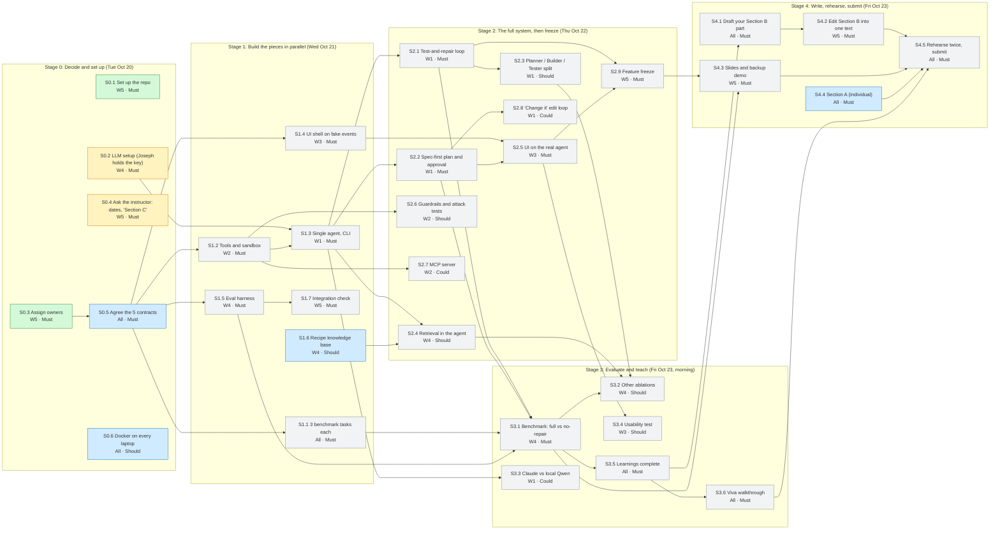

# Plan

This follows the team plan on the Drive (`NLP-GROUP-1/prosit 2/Prosit 2 Plan - NLP Group 1`): its build schedule gives the **stages**, its workstream table gives **who** does what, its day-1 contracts give the **blockers**, and its cut line gives the **priority** (Must / Should / Could).

**How to use it.** Edit only the stage tables: set `Status` to `doing` when you start, `done` when "Done when" is true. Then run `python3 scripts/update_status.py`. It redraws the board, the flow diagram, "By person", "Who waits on whom" (all below) and the README's Status section. Commit everything together. A GitHub check fails if any of it is stale.

**Dates.** The Drive schedule's Sunday–Monday targets were missed (Stage 0 is still open on Tue Oct 20), so every stage moved by two days and submission stays **Fri Oct 23**. If the instructor gives a later date (S0.4), Stages 3–4 move to it. If time runs out, finish every `Must` before any `Should`, and every `Should` before any `Could`.

## Board: stage by person

<!-- BOARD:START -->
| Who | Stage 0 Decide and set up (Tue Oct 20) | Stage 1 Build the pieces in parallel (Wed Oct 21) | Stage 2 The full system, then freeze (Thu Oct 22) | Stage 3 Evaluate and teach (Fri Oct 23, morning) | Stage 4 Write, rehearse, submit (Fri Oct 23) |
|---|---|---|---|---|---|
| Alice (W1) | — | ⏳ S1.3 Single agent, CLI | ⏳ S2.1 Test-and-repair loop ⏳ S2.2 Spec-first plan and approval ⏳ S2.3 Planner / Builder / Tester split ⏳ S2.8 "Change it" edit loop | ⏳ S3.3 Claude vs local Qwen | — |
| Bernard (W2) | — | ⏳ S1.2 Tools and sandbox | ⏳ S2.6 Guardrails and attack tests ⏳ S2.7 MCP server | — | — |
| Michael (W3) | — | ⏳ S1.4 UI shell on fake events | ⏳ S2.5 UI on the real agent | ⏳ S3.4 Usability test | — |
| Joseph (W4) | 🟡 S0.2 LLM setup (Joseph holds the key) | ⏳ S1.5 Eval harness 🔵 S1.6 Recipe knowledge base | ⏳ S2.4 Retrieval in the agent | ⏳ S3.1 Benchmark: full vs no-repair ⏳ S3.2 Other ablations | — |
| Eric (W5) | ✅ S0.1 Set up the repo ✅ S0.3 Assign owners 🟡 S0.4 Ask the instructor: dates, "Section C" | ⏳ S1.7 Integration check | ⏳ S2.9 Feature freeze | — | ⏳ S4.2 Edit Section B into one text ⏳ S4.3 Slides and backup demo |
| Everyone | 🔵 S0.5 Agree the 5 contracts 🔵 S0.6 Docker on every laptop | ⏳ S1.1 3 benchmark tasks each | — | ⏳ S3.5 Learnings complete ⏳ S3.6 Viva walkthrough | ⏳ S4.1 Draft your Section B part 🔵 S4.4 Section A (individual) ⏳ S4.5 Rehearse twice, submit |

✅ done · 🟡 in progress · 🔵 ready to start · ⏳ waiting on another task
<!-- BOARD:END -->

## Flow: what blocks what

Arrows point from a task to the tasks that need it.

<!-- FLOW:START -->

Green: done · yellow: in progress · blue: ready to start · grey: waiting on the tasks with arrows into it.
<!-- FLOW:END -->

## Stage 0: Decide and set up (Tue Oct 20)

| ID | Task | Who | Needs | Priority | Status | Done when |
|---|---|---|---|---|---|---|
| S0.1 | Set up the repo | W5 | — | Must | done | Rules, docs, learnings, knowledge and the worked benchmark example are on GitHub |
| S0.2 | LLM setup (Joseph holds the key) | W4 | — | Must | doing | Claude key tested and local Qwen tested (both done Oct 20). Remaining: the check in `knowledge/environment.md` passes for W1, W4 and the demo machine |
| S0.3 | Assign owners | W5 | — | Must | done | Owner column in "By person" filled in (Oct 20) |
| S0.4 | Ask the instructor: dates, "Section C" | W5 | — | Must | doing | Asked Oct 21, waiting for a reply. Until then: no Section C, submit Fri Oct 23. Answers go in `docs/DECISIONS.md` and `knowledge/assignment.md` |
| S0.5 | Agree the 5 contracts | All | S0.3 | Must | todo | `DRAFT` removed from `docs/CONTRACTS.md`; decision logged |
| S0.6 | Docker on every laptop | All | — | Should | todo | `docker run --rm hello-world` works for all 5 (fallback: subprocess sandbox) |

## Stage 1: Build the pieces in parallel (Wed Oct 21)

| ID | Task | Who | Needs | Priority | Status | Done when |
|---|---|---|---|---|---|---|
| S1.1 | 3 benchmark tasks each | All | S0.5 | Must | todo | 15 task folders in `benchmark/` (easy, medium, hard per person); each reference backend passes its hidden tests; W4 has checked them |
| S1.2 | Tools and sandbox | W2 | S0.5 | Must | todo | All 7 tools work on `church_signup`; Docker vs subprocess compared in W2 learnings |
| S1.3 | Single agent, CLI | W1 | S0.2, S0.5, S1.2 | Must | todo | `python -m builder build benchmark/church_signup/request.md` produces a backend that passes the hidden tests; prompt variants compared in W1 learnings |
| S1.4 | UI shell on fake events | W3 | S0.5 | Must | todo | Page goes describe → plan → progress → try it, driven by canned events |
| S1.5 | Eval harness | W4 | S0.5 | Must | todo | One command scores any config on any set of tasks, checked against the reference backends |
| S1.6 | Recipe knowledge base | W4 | — | Should | todo | `search_docs` returns relevant recipes; BM25 vs dense vs none compared in W4 learnings |
| S1.7 | Integration check | W5 | S1.5 | Must | todo | A fresh clone, following only the README, scores `church_signup` with the harness |

## Stage 2: The full system, then freeze (Thu Oct 22)

| ID | Task | Who | Needs | Priority | Status | Done when |
|---|---|---|---|---|---|---|
| S2.1 | Test-and-repair loop | W1 | S1.3 | Must | todo | Failed tests are fed back and fixed up to a retry cap; 0/1/3/5 retries compared in W1 learnings |
| S2.2 | Spec-first plan and approval | W1 | S1.3 | Must | todo | Nothing is built before the user approves; plan events reach the UI |
| S2.3 | Planner / Builder / Tester split | W1 | S2.1 | Should | todo | Split vs single agent compared on 3+ tasks in W1 learnings |
| S2.4 | Retrieval in the agent | W4 | S1.3, S1.6 | Should | todo | With vs without `search_docs` compared on 3+ tasks |
| S2.5 | UI on the real agent | W3 | S1.4, S2.2 | Must | todo | A non-developer builds the church example alone, end to end |
| S2.6 | Guardrails and attack tests | W2 | S1.2 | Should | todo | Result of each of the 5 attacks recorded in W2 learnings |
| S2.7 | MCP server | W2 | S1.2 | Could | todo | An MCP client calls our tools |
| S2.8 | "Change it" edit loop | W1 | S2.2 | Could | todo | A follow-up request edits an existing project instead of rebuilding it |
| S2.9 | Feature freeze | W5 | S2.1, S2.2, S2.5 | Must | todo | `main` runs describe → approve → build → try it from a fresh clone |

## Stage 3: Evaluate and teach (Fri Oct 23, morning)

| ID | Task | Who | Needs | Priority | Status | Done when |
|---|---|---|---|---|---|---|
| S3.1 | Benchmark: full vs no-repair | W4 | S1.1, S1.5, S2.1, S2.2 | Must | todo | Results table and chart for all tasks in `eval/results/` and W4 learnings |
| S3.2 | Other ablations | W4 | S3.1, S2.3, S2.4 | Should | todo | Single agent, no retrieval and no spec-first, scored the same way |
| S3.3 | Claude vs local Qwen | W1 | S1.3 | Could | todo | Same 3–5 tasks: pass rate, time, cost, in W1 learnings |
| S3.4 | Usability test | W3 | S2.5 | Should | todo | 4–5 non-developers: completion, time, SUS scores in W3 learnings |
| S3.5 | Learnings complete | All | S3.1 | Must | todo | All 5 files have the explanation, full experiment log, viva Q&A and glossary |
| S3.6 | Viva walkthrough | All | S3.5 | Must | todo | Each owner has taught their part; everyone can answer every workstream's viva questions |

## Stage 4: Write, rehearse, submit (Fri Oct 23)

| ID | Task | Who | Needs | Priority | Status | Done when |
|---|---|---|---|---|---|---|
| S4.1 | Draft your Section B part | All | S3.5 | Must | todo | Each owner's part (see "By person") is in the shared draft |
| S4.2 | Edit Section B into one text | W5 | S4.1, S3.1 | Must | todo | One Section B, identical in every report, reviewed by all 5 |
| S4.3 | Slides and backup demo | W5 | S2.9, S3.1 | Must | todo | 10-minute deck with the GitHub link on slide 1; a demo recording saved |
| S4.4 | Section A (individual) | All | — | Must | todo | 3–5 pages each, own words, topics a–r told as one story |
| S4.5 | Rehearse twice, submit | All | S4.2, S4.3, S4.4, S3.6 | Must | todo | Two timed run-throughs; report and slides on Canvas with the GitHub link on page 1 |

## By person

What each person owns, from the Drive plan's workstream table. `All` tasks are done by everyone (Section A individually). The task list under the table is generated.

| Workstream | Owns | Drafts in Section B | Section A cluster | Talk slot | Owner |
|---|---|---|---|---|---|
| W1 | Agent core: ReAct loop, prompts, Planner / Builder / Tester, orchestrator, project memory, CLI | Approach; agent design | 4. Agents | The agent loop, shown live (2 min) | Alice |
| W2 | Runtime, tools and safety: the 7 tools, Docker sandbox, test runner, server launcher, MCP server, guardrails, attack tests | Sandbox and security; MCP | 5. Safety and people | Running untrusted code safely (1.5 min) | Bernard |
| W3 | Product UI and usability: chat page, plan approval, progress, try-it panel, downloads; the usability test | Interface; human-in-the-loop design; usability results | 2. Prompting and reasoning | The user's journey (2 min) | Michael |
| W4 | Evaluation and knowledge base: benchmark format, harness, ablations, results and charts; the recipe knowledge base | Evaluation | 3. Knowledge, memory and tools | Results and ablations (2 min) | Joseph |
| W5 | Lead, integration and writing: repo, README, integration, daily check-ins, Section B editing, slides, viva drill | Architecture overview; final edit of all of B | 1. From LM to assistant | Opening, problem, architecture and close (2.5 min) | Eric |

<!-- PEOPLE:START -->
**Alice (W1)**

1. S1.3 Single agent, CLI — Must, waiting (waiting on S0.2, S0.5, S1.2)
2. S2.1 Test-and-repair loop — Must, waiting (waiting on S1.3)
3. S2.2 Spec-first plan and approval — Must, waiting (waiting on S1.3)
4. S2.3 Planner / Builder / Tester split — Should, waiting (waiting on S2.1)
5. S2.8 "Change it" edit loop — Could, waiting (waiting on S2.2)
6. S3.3 Claude vs local Qwen — Could, waiting (waiting on S1.3)

**Bernard (W2)**

1. S1.2 Tools and sandbox — Must, waiting (waiting on S0.5)
2. S2.6 Guardrails and attack tests — Should, waiting (waiting on S1.2)
3. S2.7 MCP server — Could, waiting (waiting on S1.2)

**Michael (W3)**

1. S1.4 UI shell on fake events — Must, waiting (waiting on S0.5)
2. S2.5 UI on the real agent — Must, waiting (waiting on S1.4, S2.2)
3. S3.4 Usability test — Should, waiting (waiting on S2.5)

**Joseph (W4)**

1. S0.2 LLM setup (Joseph holds the key) — Must, doing
2. S1.5 Eval harness — Must, waiting (waiting on S0.5)
3. S1.6 Recipe knowledge base — Should, ready
4. S2.4 Retrieval in the agent — Should, waiting (waiting on S1.3, S1.6)
5. S3.1 Benchmark: full vs no-repair — Must, waiting (waiting on S1.1, S1.5, S2.1, S2.2)
6. S3.2 Other ablations — Should, waiting (waiting on S3.1, S2.3, S2.4)

**Eric (W5)**

1. S0.1 Set up the repo — Must, done
2. S0.3 Assign owners — Must, done
3. S0.4 Ask the instructor: dates, "Section C" — Must, doing
4. S1.7 Integration check — Must, waiting (waiting on S1.5)
5. S2.9 Feature freeze — Must, waiting (waiting on S2.1, S2.2, S2.5)
6. S4.2 Edit Section B into one text — Must, waiting (waiting on S4.1, S3.1)
7. S4.3 Slides and backup demo — Must, waiting (waiting on S2.9, S3.1)

**Everyone**

1. S0.5 Agree the 5 contracts — Must, ready
2. S0.6 Docker on every laptop — Should, ready
3. S1.1 3 benchmark tasks each — Must, waiting (waiting on S0.5)
4. S3.5 Learnings complete — Must, waiting (waiting on S3.1)
5. S3.6 Viva walkthrough — Must, waiting (waiting on S3.5)
6. S4.1 Draft your Section B part — Must, waiting (waiting on S3.5)
7. S4.4 Section A (individual) — Must, ready
8. S4.5 Rehearse twice, submit — Must, waiting (waiting on S4.2, S4.3, S4.4, S3.6)
<!-- PEOPLE:END -->

## Who waits on whom

Generated: every place where one person's task cannot finish until another person's task is done. These are the hand-offs to talk about at the daily check-in.

<!-- BLOCKERS:START -->
- S1.2 Tools and sandbox (Bernard (W2)) waits on S0.5 Agree the 5 contracts (Everyone)
- S1.3 Single agent, CLI (Alice (W1)) waits on S0.2 LLM setup (Joseph holds the key) (Joseph (W4))
- S1.3 Single agent, CLI (Alice (W1)) waits on S0.5 Agree the 5 contracts (Everyone)
- S1.3 Single agent, CLI (Alice (W1)) waits on S1.2 Tools and sandbox (Bernard (W2))
- S1.4 UI shell on fake events (Michael (W3)) waits on S0.5 Agree the 5 contracts (Everyone)
- S1.5 Eval harness (Joseph (W4)) waits on S0.5 Agree the 5 contracts (Everyone)
- S1.7 Integration check (Eric (W5)) waits on S1.5 Eval harness (Joseph (W4))
- S2.4 Retrieval in the agent (Joseph (W4)) waits on S1.3 Single agent, CLI (Alice (W1))
- S2.5 UI on the real agent (Michael (W3)) waits on S2.2 Spec-first plan and approval (Alice (W1))
- S2.9 Feature freeze (Eric (W5)) waits on S2.1 Test-and-repair loop (Alice (W1))
- S2.9 Feature freeze (Eric (W5)) waits on S2.2 Spec-first plan and approval (Alice (W1))
- S2.9 Feature freeze (Eric (W5)) waits on S2.5 UI on the real agent (Michael (W3))
- S3.1 Benchmark: full vs no-repair (Joseph (W4)) waits on S1.1 3 benchmark tasks each (Everyone)
- S3.1 Benchmark: full vs no-repair (Joseph (W4)) waits on S2.1 Test-and-repair loop (Alice (W1))
- S3.1 Benchmark: full vs no-repair (Joseph (W4)) waits on S2.2 Spec-first plan and approval (Alice (W1))
- S3.2 Other ablations (Joseph (W4)) waits on S2.3 Planner / Builder / Tester split (Alice (W1))
- S3.5 Learnings complete (Everyone) waits on S3.1 Benchmark: full vs no-repair (Joseph (W4))
- S4.2 Edit Section B into one text (Eric (W5)) waits on S4.1 Draft your Section B part (Everyone)
- S4.2 Edit Section B into one text (Eric (W5)) waits on S3.1 Benchmark: full vs no-repair (Joseph (W4))
- S4.3 Slides and backup demo (Eric (W5)) waits on S3.1 Benchmark: full vs no-repair (Joseph (W4))
- S4.5 Rehearse twice, submit (Everyone) waits on S4.2 Edit Section B into one text (Eric (W5))
- S4.5 Rehearse twice, submit (Everyone) waits on S4.3 Slides and backup demo (Eric (W5))
<!-- BLOCKERS:END -->
