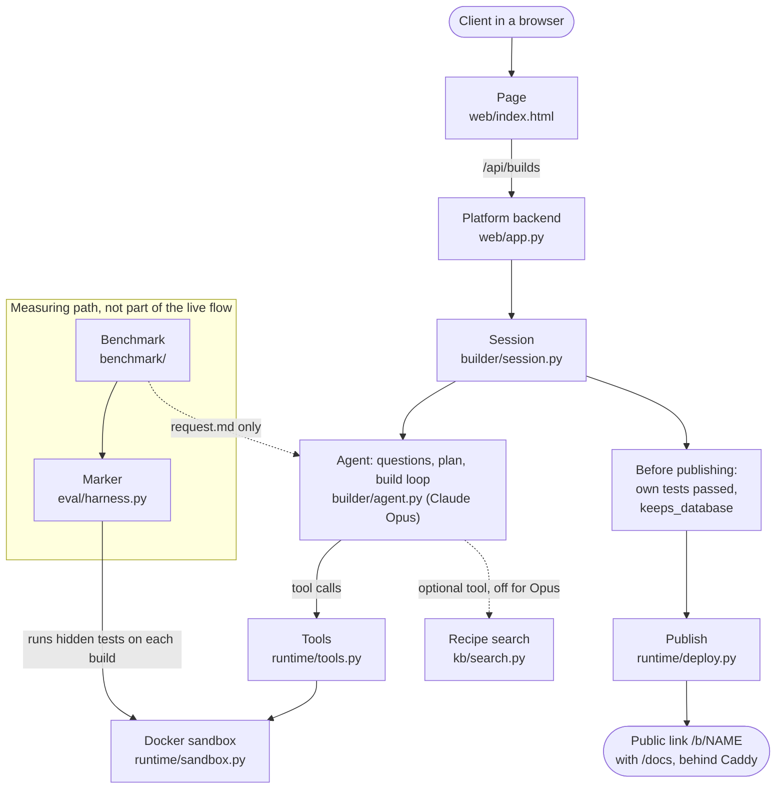
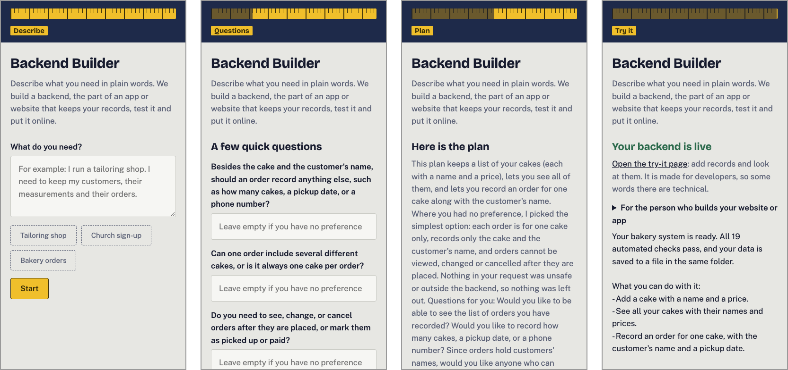
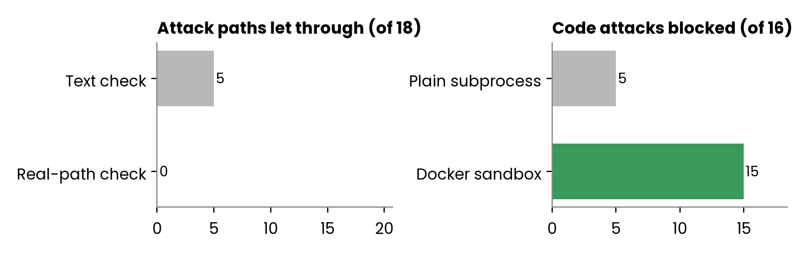
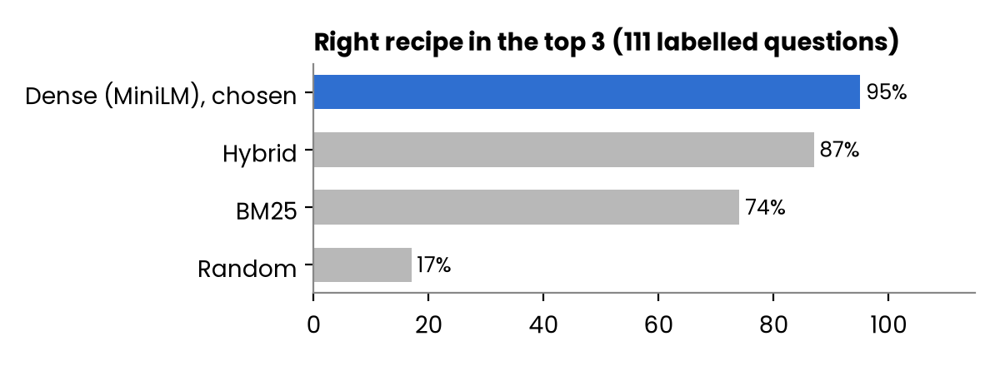
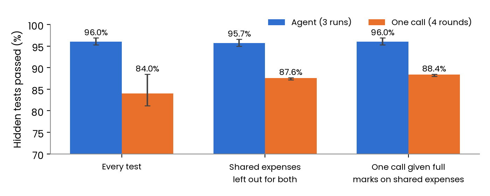
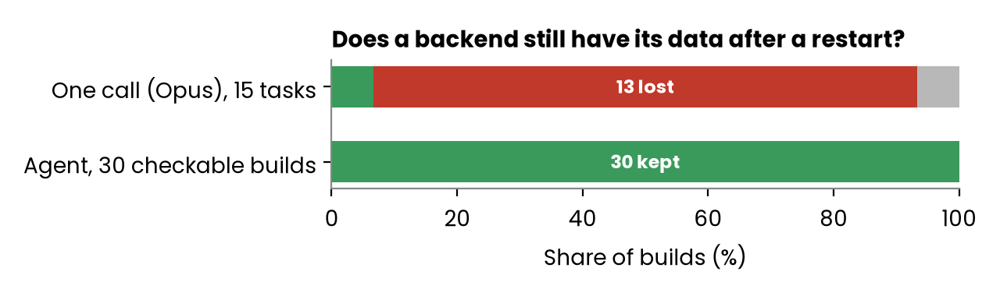
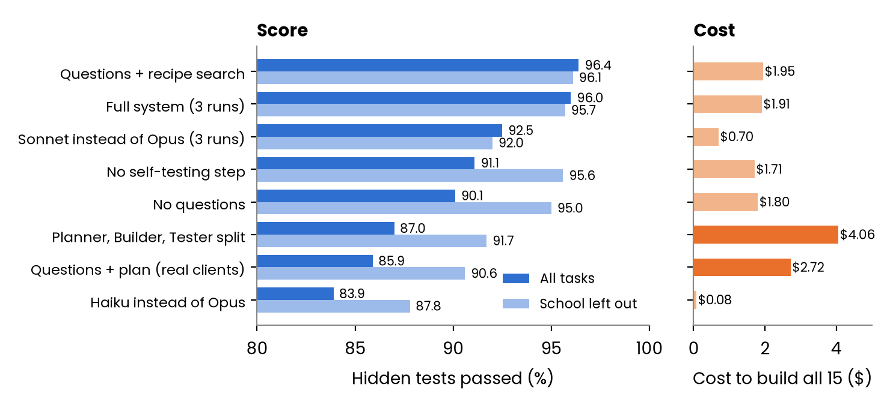
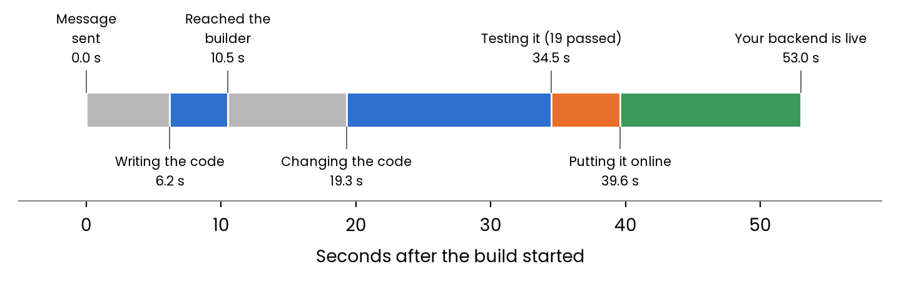

Code: https://github.com/ASU-MICS-2028/nlp-group-1-prosit-2

# Section B: How we built the platform

*Identical in every member's report. (W1 row 7) means row 7 of the experiment log in `learnings/W1-agent-core.md`, and likewise for W2 to W5.*

## 1 Approach

**The problem.** Mesora asked for a platform that lets non-developers build backend APIs. A backend stores data and answers requests; its API is the fixed set of requests it accepts, each one an endpoint such as `POST /events`. Lecture 8 set the bar: a working backend that we host, with a real database, its link and endpoints, and an agent that takes follow-up messages during a build (knowledge/assignment.md).

**Our answer.** The client describes a backend in plain words. An LLM coding agent asks up to 3 questions (W1 row 7) and shows a plan for approval. It then writes a FastAPI app that stores data in SQLite, tests it with pytest inside a locked Docker sandbox, and publishes it at a public link.

**How we worked.** Each workstream had one owner (decision 0011): W1 Alice the agent, W2 Bernard the tools and sandbox, W3 Michael the page design, W4 Joseph the benchmark, recipe search and live platform, and W5 Eric the integration and this report. We tested every alternative (decision 0001) and saved every result in `eval/results/` (decision 0051). Before the agent existed, W4 wrote a benchmark of 15 requests in a non-developer's words, with 192 hidden tests the agent never sees, and a baseline: one Claude call, with no tools, writing the whole backend (W4 section 2).

**A hand-written loop.** One call cannot run what it writes; an agent can. The model asks for an action, our code does it and reports back, until the model is finished (the ReAct pattern). We wrote this loop by hand rather than with a framework, so every line can be explained (decision 0003).

## 2 Architecture

*Figure 1. The parts of the platform. Dotted arrows are optional, or used only when we measure.*

<!-- Word and PDF do not draw Mermaid: paste docs/section-b-figure-1.png in its place. -->

**Page and session.** The page never talks to the agent: it sends everything to the platform backend and polls it every 1.5 seconds (W3 section 4). Each client gets a session that moves through fixed states: asking, waiting for answers, planning, waiting for approval, building, then live or failed. A message sent during a build reaches the agent between turns (W4 row 31). A session allows at most $10 of spending a day and 2 builds at once (decision 0048).

*Figure 2. The page on the public link at phone width, from one real build: describe, answer the questions, approve the plan, live (eval/results/browser_check_2026-11-14).*

**Agent** (W1 Alice). One Claude call writes the questions, and a second fills a fixed plan form for the client to approve: the data kept, the endpoints and the rules (decision 0041). Then the loop runs until Claude finishes or reaches 40 turns or $2 (W1 section 4). Claude has 8 tools: write, read and edit a file, list files, run the tests, start the server, send it a request, and stop it (W1 section 2).

**Sandbox** (W2 Bernard). Running the tests or the server starts a fresh Docker container that sees only the project folder, has no internet, 512 MB of memory, 1 CPU and 128 processes, and runs as an ordinary user (W2 section 1). A tiny door container forwards one port, so we can reach the server but it cannot reach out (W2 row 10).

**Publishing** (W4 Joseph). The session publishes only if the agent's own tests passed (decision 0048) and a restarted copy loses no rows (decision 0053). The backend then runs on one Google Cloud server with the sandbox's locks, behind Caddy, which gives it an HTTPS link and a `/docs` page listing its endpoints (W4 section 2).

## 3 Implementation choices

| Choice | Lost against it | What we measured | Source |
|---|---|---|---|
| Path guard: find where a path really ends, then check it is inside the project | Checking the text of the path | Of 18 attack paths, the text check let 5 through, the real-path check 0 | W2 row 1, W4 row 6 |
| Docker sandbox | Plain subprocess | Of 16 harmful-code attacks, Docker blocked 15, subprocess 5 | W2 row 13 |
| Server on a private network behind a door | No network; Docker's normal network | Only the door blocked the internet and still let our computer in | W2 row 10 |
| Dense search (all-MiniLM-L6-v2), top 3 | BM25, hybrid, random | Right recipe in the top 3: 95%, against hybrid 87%, BM25 74%, random 17% | W4 row 24 |
| Ask up to 3 questions first | No questions | 96.0% against 90.1% | eval/results/tables.md |
| One agent | Planner, Builder and Tester split | 96.0% at $1.91 against 87.0% at $4.06 | eval/results/tables.md |
| Opus builds | Sonnet, Haiku, local Qwen | 96.0%, against Sonnet 92.5% and Haiku 83.9% | eval/results/tables.md, decision 0056 |

*Table 1. The main choices and the options that lost.*

*Figure 3. The two safety choices that won (W2 rows 1 and 13).*

**Agent design (W1).** Four system prompts scored between 86.5% and 88.5%, too close to separate (W1 row 1). An independent checker passed 15 of 15 apps first time, so extra repair rounds changed nothing and are off (decision 0040). The failing apps were not broken: they read the request differently from the hidden tests. Questions fix that: on the vague school task, Opus asked about the grading scale, and the task went from 3 of 12 tests to 12 of 12 (W1 rows 6 and 7). A Planner, Builder and Tester split locked in a design before any code was tried, and its Tester's repairs ran 0 times (W4 row 51, decision 0044).

**Recipe search (W4).** The instructor expected dense retrieval, so a choice of BM25 would need defending with numbers (knowledge/assignment.md). BM25 ranks recipes by shared words; dense search compares meanings as lists of numbers (embeddings). On 111 labelled questions, MiniLM put the right recipe in the top 3 most often, and the agent reads 3 (W4 rows 23 and 24, decision 0037).

*Figure 4. How often the right recipe was in the top 3 results (W4 row 24).*

**Smaller choices.** `read_file` returns up to 20,000 characters, because cutting files at 4,000 made changes take 24 turns instead of 13 (W4 row 36, decision 0052). A Haiku rewrite of the build summary removed technical words for $0.011 against $0.294 with Opus (W4 row 40). A change edits the existing app, so the client keeps their routes and data (W1 row 9).

## 4 Evaluation

**4.1 Is the marker fair?** Each task has a hand-written correct backend that must pass every hidden test, and broken copies that must each fail one. All 75 broken copies were caught (W4 row 7), and the correct backends scored 100% in 105 of 105 re-scorings (W4 row 19): what varies is the build, not the marker. Reading every failing test found 7 flaws in how tests reach a backend, and fixing them reversed a conclusion (W4 row 12).

**4.2 The agent against one call.**

| | Agent (3 runs) | One call (4 rounds) |
|---|---|---|
| Every test | 96.0% (95.3 to 96.9) | 84.0% (81.2 to 88.5) |
| Leaving shared expenses out for both | 95.7% (95.0 to 96.6) | 87.6% (87.2 to 87.7) |
| One call given full marks on shared expenses | 96.0% (95.3 to 96.9) | 88.4% (88.0 to 88.5) |

*Table 2. Share of hidden tests passed, with the range across runs (eval/results/tables.md).*

*Figure 5. Table 2 as a chart; the bars show the range across runs.*

One task, shared expenses, swings the one-call score; left out for both, or with full marks for one call, the agent still leads by about 8 points (W4 row 44). Two caveats: the agent also gets the client's answers, and its average mixes one run under older scoring rules with two rescored runs (W4 row 44, W5 row 12).

The score hides data loss, since the hidden tests never restart a backend. One call lost its data on 13 of 15 tasks; the agent kept it in all 30 builds that could be checked (W4 row 37, eval/results/tables.md).

*Figure 6. Whether a backend still had its data after a restart.*

**4.3 What each part adds.** An ablation removes one part and measures the change: one build per setup, scored 3 times. Gaps under about 2 points are noise, and one choice in the school task moves 10 tests, so school is shown both ways (eval/results/tables.md).

| Setup | All tasks | School left out | Cost to build all 15 |
|---|---|---|---|
| Questions + recipe search | 96.4% | 96.1% | $1.95 |
| Full system: questions, no plan (3 runs) | 96.0% | 95.7% | $1.91 |
| Sonnet instead of Opus (3 runs) | 92.5% | 92.0% | $0.70 |
| No self-testing step (prompt D) | 91.1% | 95.6% | $1.71 |
| No questions | 90.1% | 95.0% | $1.80 |
| Planner, Builder, Tester split | 87.0% | 91.7% | $4.06 |
| Questions + plan (what real clients get) | 85.9% | 90.6% | $2.72 |
| Haiku instead of Opus | 83.9% | 87.8% | $0.08 |

*Table 3. Each setup on all 15 tasks (eval/results/tables.md).*

*Figure 7. Score and cost of each setup in Table 3.*

With school left out, self-testing, recipe search and questions make little measurable difference (W4 section 7). We keep self-testing because the platform refuses to publish a build whose own tests did not run and pass (W4 row 49). An unread plan costs about 5 points (W4 row 48), but real clients read theirs and can correct it. Recipes matter for a small model: a local Qwen 3.5 9B scored 0% alone and 59.0% with search on 5 easy tasks (eval/results/tables.md).

**4.4 The live platform and its safety.** Real builds through the public page went live with no page errors (W4 row 45), and a message sent mid-build was obeyed in 8 of 8 builds (W4 row 41). Attacked from inside a backend, the server stopped memory use at 512 MB and a 300-process attack at 126, and the gaps found (open ports, a full disk, huge requests) were closed and held when attacked again (W4 rows 54 to 59). Instructions hidden in a request were obeyed in 0 of 9 test builds (W2 row 14).

*Figure 8. One real build on the public link, with a message sent at the start: what the page showed and when (eval/results/browser_check_2026-11-14).*

**4.5 Usability.** One non-developer, working alone on the public link, went from a request for a car dealership's records to a live backend in about 10 minutes, then added and listed cars through its docs page (eval/results/usability/results.md). They finished 4 of the 6 test tasks without help. The plan screen confused them: answers typed under the plan only apply after pressing "Change the plan", and the rounds of questions tired them. One person is weak evidence, and the SUS form is still to do. With the same saved build played back, the technical words on the live screen went from 4 (GET, POST, docs, https) to 0 after Michael's redesign (W3 rows 4 and 7).

**4.6 Do the numbers hold?** An audit matched 105 written numbers to their saved files (eval/results/AUDIT.md), and W5 reran every free check from a fresh copy of the repo (W5 row 15).

## 5 Limits

- **Small benchmark.** The 15 tasks are ours, and each ablation is a single build (eval/results/tables.md).
- **Safety gaps.** Generated code can still delete its own project's files (W2 row 13), and 4 injection tries on the live platform prove little (W4 section 5).
- **One small server.** It has 4 GB for every backend and build, and no backups (W4 section 5). Backends have no login unless the client asks for one.
- **Retrieval.** Search cannot tell that no recipe fits (W4 row 25), and questions in Twi return noise (W4 row 26).
