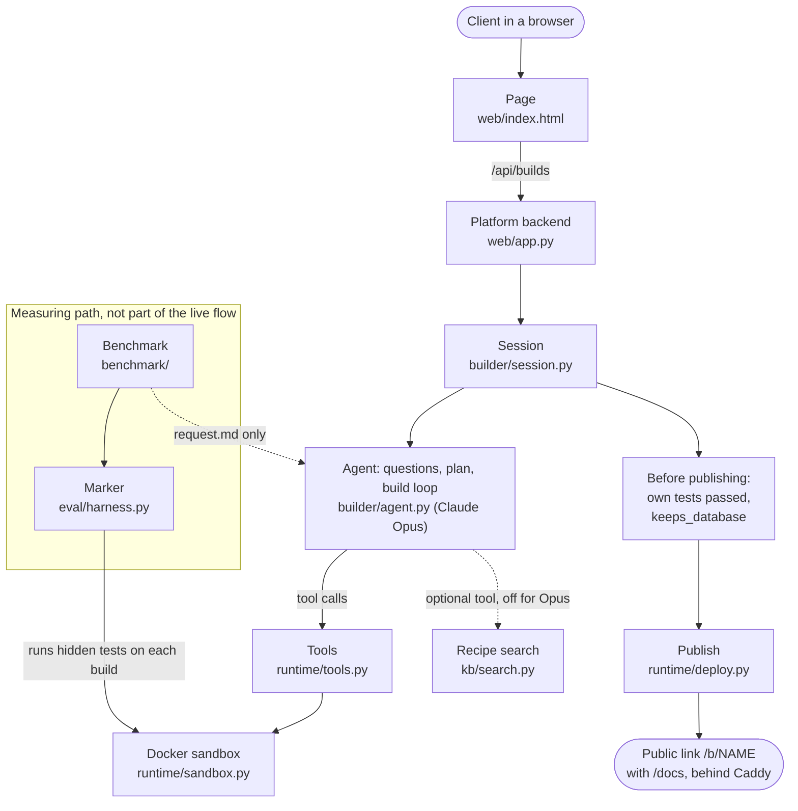

Code: https://github.com/ASU-MICS-2028/nlp-group-1-prosit-2

# Section B: How we built the platform

*Identical in every member's report. (W1 row 7) means row 7 of the experiment log in `learnings/W1-agent-core.md`, and likewise for W2 to W5.*

## 1 Approach

**The problem.** Mesora asked for a platform that lets non-developers build backend APIs (knowledge/assignment.md). A backend stores data and answers requests; an API is the fixed set of requests it accepts, each one an endpoint such as `POST /events`. Lecture 8 set the bar: a working backend that we host, with a real database, its link and its endpoints, and an agent that takes follow-up messages during a build (knowledge/assignment.md).

**Our answer.** The client describes a backend in plain words. An LLM coding agent asks up to 3 questions (W1 row 7) and shows a plan for approval. It then writes a FastAPI app that stores data in SQLite, tests it with pytest inside a locked Docker sandbox, and publishes it at a public link.

**How we worked.** Each workstream had one owner (decision 0011): W2 Bernard the tools and sandbox, W4 Joseph the benchmark, marker, recipe search and live platform, W1 Alice the agent, W3 Michael the page design, and W5 Eric the integration and this report. Each owner writes a learnings file, and the others build only on it. We test every alternative (decision 0001), and every result is saved in `eval/results/` (decision 0051).

**Measure first.** Before the agent existed, W4 wrote a benchmark of 15 requests in a non-developer's words, with 192 hidden tests the agent never sees (W4 section 2). W4 also measured a baseline: one Claude call, with no tools, writes the whole backend. Every build uses one stack, FastAPI, SQLModel, SQLite and pytest (decision 0002), so builds are comparable.

**A hand-written loop.** One call cannot run what it writes. An agent can: the model asks for an action, our code does it and reports back, until the model is finished (the ReAct pattern: reason, act, look at the result). We wrote the loop by hand rather than with a framework, so every line can be explained (decision 0003). This was reasoned, not measured; Lecture 8 advised a framework but left the choice to us (knowledge/assignment.md).

## 2 Architecture

*Figure 1. The parts of the platform. Dotted arrows are optional, or used only when we measure.*

<!-- Word and PDF do not draw Mermaid: paste docs/section-b-figure-1.png in its place. -->

**Page and platform backend.** The page (`web/index.html`) never talks to the agent. It sends everything to the platform backend (`web/app.py`) at `/api/builds` and polls it every 1.5 seconds (W3 section 4). Each client gets a session (`builder/session.py`, decision 0048) that moves through fixed states: asking, waiting for answers, planning, waiting for approval, building, then live or failed (W4 section 2). A message sent during a build reaches the agent between turns (W4 row 31). The session allows at most $10 of spending a day, 2 builds at once and 5,000 characters per request (decision 0048).

**Agent** (`builder/agent.py`, W1 Alice). One Claude call with no tools writes the questions, and the answers join the request (W1 section 2). A second call fills a fixed plan form for the client to approve: the data kept, the endpoints and the rules (decision 0041). Then the loop runs: Claude asks for tools, and our code runs them in a project folder it chose and returns the result, until Claude finishes or reaches 40 turns or $2 (W1 section 4). Recipe search (`kb/search.py`) is an optional extra tool, off for Opus (decision 0043).

**Tools and sandbox** (`runtime/`, W2 Bernard). Claude gets 8 tools: write, read and edit a file, list files, run the tests, start the server, send it a request, and stop it (W1 section 2). `run_tests` and `start_server` run generated code in a fresh Docker container, a small separate Linux computer thrown away afterwards. It sees only the project folder, has no internet, gets 512 MB of memory, 1 CPU and 128 processes, and runs as an ordinary user with read-only system files (W2 section 1). A tiny door container forwards one port, so we can reach the server but it cannot reach out (W2 row 10).

**Publishing and measuring** (`runtime/deploy.py`, `eval/harness.py`, W4 Joseph). The session publishes only if the agent's own tests ran and passed (decision 0048) and `keeps_database` finds that a restarted copy loses no rows (decision 0053). `deploy` runs `app.py` on one Google Cloud server with the sandbox's locks, and Caddy, a small web server in front, gives it an HTTPS path with a `/docs` page listing its endpoints (W4 section 2). To measure, the harness runs a task's hidden tests on the build in the same sandbox (W4 section 2).

## 3 Implementation choices

| Choice | Lost against it | What we measured | Source |
|---|---|---|---|
| Path guard: find where a path really ends, then check it is inside the project | Checking the text of the path | 18 attack paths among 24: the text check let 5 through, the real-path check 0 (on a Mac, 2 harmless names that stay inside the project) | W2 row 1, W4 row 6 |
| Docker sandbox | Plain subprocess | Of 16 harmful-code attacks, Docker blocked 15, subprocess 5 | W2 row 13 |
| Server on a private network behind a door | No network; Docker's normal network | Only the door blocked the internet and still let our computer in | W2 row 10 |
| Keep the start and the end of long tool output | Keep only the start | 21 of 21 key facts kept, against 14 to 20 of 21 | W2 row 5 |
| Dense search (all-MiniLM-L6-v2), top 3 | BM25, bigger dense models, hybrid, random | Right recipe in the top 3: 95%, against BM25 74%, hybrid 87%, random 17% | W4 row 24 |
| Ask up to 3 questions first | No questions | 96.0% against 90.1%; school left out, 95.7% against 95.0% | eval/results/tables.md |
| One agent | Planner, Builder and Tester split | 96.0% at $1.91 against 87.0% at $4.06 | eval/results/tables.md |
| Opus builds | Sonnet, Haiku, local Qwen | 96.0%, against Sonnet 92.5% and Haiku 83.9% | eval/results/tables.md, decision 0056 |

*Table 1. The main choices and the options that lost.*

**Tools and sandbox (W2).** Docker adds about 2 to 3 seconds per call on Windows (W2 row 11) and under 1 second on a Mac (eval/results/AUDIT.md), small next to an LLM step. `read_file` first cut files at 4,000 characters, but 10 of 15 Opus apps were bigger (W2 row 4); with no cut, changes took 13 turns and $0.350 instead of 24 turns and $0.426, with the same hidden-test results (W4 row 36), so it now returns up to 20,000 characters (decision 0052). There is no filter on requests: a word filter is easy to dodge, and the actions an attack wants are blocked further down (decision 0029).

**Agent and plan (W1).** These prompt, repair and plan figures come from single builds under the earlier rules, before questions existed (W1 rows 1 to 5, W4 row 43). Four system prompts scored 87.5%, 87.0%, 88.5% and 86.5%, too close to separate, so we kept B, which follows the SQLite rule (W1 row 1). An independent checker, a second Claude call that writes its own tests from the request alone, passed 15 of 15 apps first time, so 0, 1, 3 and 5 repair rounds all scored 87.0% (W1 row 3), and repairs are off by default (decision 0040). The failing apps were not broken: they read the request differently from the hidden tests. Questions fix that: on the vague school task, Opus asked about the grading scale (W1 row 6), and the task went from 3 of 12 to 12 of 12 (W1 row 7). Unread plans scored lower: the first planner added logins nobody asked for and scored 74.5%, a stricter one 82.8%, against 87.0% with no plan (W1 rows 4 and 5). Real clients still get the plan, because a person can fix it before paying for code; benchmark runs skip it (decision 0041). A Planner, Builder and Tester split (a multi-agent design) locks in a design before any code is tried, and its Tester's repairs ran 0 times (W4 row 51, decision 0044).

**Retrieval (W4).** The instructor said projects would most likely use dense retrieval, so a choice of BM25 would need defending with numbers (knowledge/assignment.md). BM25 ranks recipes by shared words, rare ones counting most; dense search turns text into lists of numbers that capture meaning (embeddings). On 111 labelled questions (W4 row 23), a hybrid was best for the first result alone, 72% against 68% for MiniLM (W4 row 24), but the agent reads 3 recipes, so we chose MiniLM (decision 0037).

**The live platform.** One Google Cloud server behind Caddy was reasoned, not measured against other hosting (W4 row 28), as were mid-build messages between turns (W4 row 31) and the page as one plain HTML file, since the server has no Node (W3 row 2). A Haiku rewrite of the client's build summary took summaries with technical words from 15 of 15 to 0 of 15, as Opus did, for $0.011 against $0.294 (W4 row 40). A change edits the existing app instead of rebuilding it, so the client keeps their routes and data (W1 row 9).

## 4 Evaluation

**4.1 Is the marker fair?** Each task has a hand-written correct backend that must pass every hidden test, and broken copies (mutants) that must each fail one. All 75 of 75 were caught (W4 row 7), the 21 correct backends score 272 of 272 (W5 row 6), and re-scoring them gave 100% in 105 of 105 runs (W4 row 19): what varies is the build, not the marker. Valid builds name things differently, so tests call operations by name and Opus maps them to each backend's paths and fields (W4 section 2). Reading every failing test found 7 flaws in this translation, and fixing them reversed a conclusion (W4 row 12). Later the marker accepted builds that find a record by name or number instead of an internal ID; the hand-written backends stayed at 272 of 272 (W4 row 43, decision 0055).

**4.2 The agent against one call.**

| | Agent (3 runs) | One call (4 rounds) |
|---|---|---|
| Every test | 96.0% (95.3 to 96.9) | 84.0% (81.2 to 88.5) |
| Leaving shared expenses out for both | 95.7% (95.0 to 96.6) | 87.6% (87.2 to 87.7) |
| One call given full marks on shared expenses | 96.0% (95.3 to 96.9) | 88.4% (88.0 to 88.5) |

*Table 2. Share of hidden tests passed, with the range across runs (eval/results/tables.md).*

One task, shared expenses, swings the one-call score, because in some rounds a member has no ID that a name map could translate; left out for both, or with full marks for one call, the agent still leads by about 8 points (W4 row 44). One call fails every round on the mobile-money wallet (3 of 13) and the school task (2 of 12), which the agent passes after asking questions (W4 row 44). Three caveats: the agent also gets the client's answers (W4 row 44); its average mixes one run under the old scoring rules with two rescored runs (W5 row 12); and it has no plan step, which real clients get (W4 row 48).

The score hides data loss, since the hidden tests never restart a backend. One call with Opus lost its data on 13 of 15 tasks and kept it on 1 (W4 row 37); the agent kept it in all 30 builds that could be checked (eval/results/tables.md). In 13 of 15 tasks every test passes in every run (W4 row 46). A build takes about 37 seconds (eval/results/tables.md).

**4.3 What each part adds.** An ablation removes one part, keeps the rest, and measures the change. Table 3 has one build per setup, scored 3 times. Gaps under about 2 points are noise, and one choice in the school task moves 10 tests (eval/results/tables.md), so school is shown both ways.

| Setup | All tasks | School left out | Cost to build all 15 |
|---|---|---|---|
| Questions + recipe search | 96.4% | 96.1% | $1.95 |
| Full system: questions, no plan (3 runs) | 96.0% | 95.7% | $1.91 |
| Sonnet instead of Opus (3 runs) | 92.5% | 92.0% | $0.70 |
| No self-testing step (prompt D) | 91.1% | 95.6% | $1.71 |
| No questions | 90.1% | 95.0% | $1.80 |
| Planner, Builder, Tester split | 87.0% | 91.7% | $4.06 |
| Questions + plan (what real clients get) | 85.9% | 90.6% | $2.72 |
| Haiku instead of Opus | 83.9% | 87.8% | $0.08 |

*Table 3. Each setup on all 15 tasks (eval/results/tables.md).*

With school left out, self-testing, recipe search and questions make little measurable difference (W4 section 7). We keep self-testing because the platform refuses to publish a build whose own tests did not run and pass (W4 row 49). An unread plan costs about 5 points (W4 row 48). Recipes matter for a small model: as the agent's model on 5 easy tasks, Qwen 3.5 9B scored 0% alone and 59.0% with search (eval/results/tables.md), while Opus searched only 2 times in 15 builds (W1 row 8).

**4.4 The live platform and its safety.** A full journey through the public page, in Chrome at phone width, went live with no page errors (W4 row 45). A message sent mid-build, to require a value or remove a feature, was obeyed in 8 of 8 builds (W4 row 41). Attacked from inside a backend, the server killed memory use at 512 MB and stopped 300 processes at 126, but its own SSH and web ports were open; a firewall rule now closes them (W4 row 54). A 200 MB file limit and a watchdog at 500 MB keep the disk from filling (W4 row 55), Caddy refuses requests over 1 MB (W4 row 56), and all four fixes held when the attacks were rerun (W4 row 59). Prompt injection, instructions hidden in a request, was obeyed in 0 of 9 test builds (W2 row 14), and all 4 tries on the live platform were spotted when planning (W4 row 57).

**4.5 Usability.** [S4.5 RESULTS: not yet run]. The plan exists so a person can correct it, which only a test with non-developers can measure. So far we have a word count: the new plan screen shows no technical words, where the old one showed GET and POST (W3 row 4).

**4.6 Do the numbers hold?** An audit matched 105 written numbers to their saved files (eval/results/AUDIT.md). W5 reran the free checks on a second Mac from the learnings files alone (W5 rows 5 to 12), then from a fresh copy, where every free part passed (W5 row 15).

## 5 Limits

- **Small benchmark.** The 15 tasks are ours, and each ablation is a single build (eval/results/tables.md).
- **A rule written after the fact.** The name-or-number rule came after we saw the failures; the hand-written backends are its check (decision 0055).
- **No person in the loop.** With an unread plan the score was 85.9% (eval/results/tables.md). [S4.5 RESULTS: not yet run]
- **Safety gaps.** Generated code can still delete the project's own files (W2 row 13). Four injection tries prove little, the watchdog overshoots (996 and 1,155 MB against 500), and requests over 1 MB get a plain error page (W4 section 5).
- **One small server.** It has 4 GB for every backend and build, and no backups (W4 section 5). Pulling the plug 5 seconds after a write lost that write (W4 row 30). Backends have no login unless the client asks, so anyone with the link can add data (W4 section 5).
- **Retrieval.** Search cannot tell that no recipe fits (W4 row 25), and questions in Twi return noise (W4 row 26).
- **Not yet live.** The new page design and the take-down button reach the public address only at the next server update (W3 section 5).
